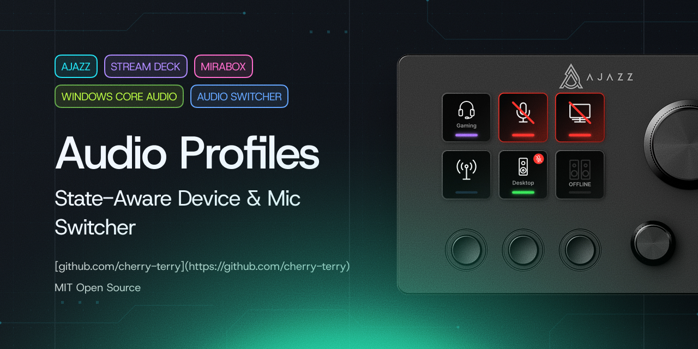
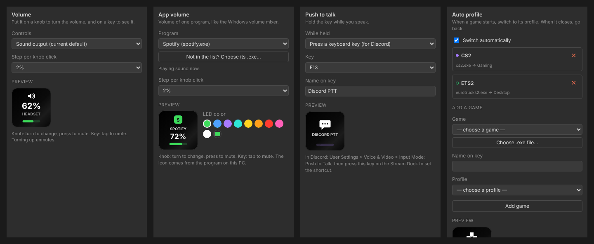

<div align="center">



# 🎧 Audio Profiles

**Switch Windows speakers, headphones, microphones and whole audio setups from your Stream Dock. Turn volume on the knobs, mix programs, push to talk and let games pick their own profile.**

[](https://github.com/cherry-terry/ajazz-audio-profiles/archive/refs/heads/main.zip)


</div>

---

## ✨ Features

- 🔊 **One tap to switch** the default speakers, headphones or microphone for every app.
- 🎚️ **Profiles**: an output, a microphone, an icon and an LED color in one key. Flip between two setups (say, *Gaming* and *Desktop*) with a single tap.
- 💡 **LEDs follow the real Windows state**: change devices in the tray or in a game and the keys update on their own.
- 🔇 **Mic mute** with a hold, shown as a red crossed-out mic or a red badge on the profile key.
- 🔌 **Devices are remembered** by ID and by name, so a headset in a different USB port is still found.
- 🎛️ **Volume on the knobs**: output and microphone, a program, or a program picker. Press a knob to mute.
- 🗣️ **Push to talk** for Discord (sends F13 or another key) or for the Windows mic itself.
- 🎮 **Auto profile**: a game starts, its profile turns on. The game closes, your devices come back.
- 🎯 **Focus mode**: one program (Discord by default) stays loud, everything else is turned down to 20%.
- 📈 **Mic level** meter and a **Previous profile** key.
- 🪶 **Nothing to install**: no admin rights, no account. The bundled helper starts and stops with the plugin.

## 📦 Installation

> [!IMPORTANT]
> Quit Stream Dock completely, including the tray icon, before copying files.

1. Copy the `com.diy.audioprofiles.sdPlugin` folder to
   `%APPDATA%\HotSpot\StreamDock\plugins\`
2. Start Stream Dock.
3. Drag actions from the **Audio Profiles** category onto your keys.

## 🎛️ Actions

| Action | Tap | Hold (0.5 s) | LED lights when |
|---|---|---|---|
| **Sound Output** | Make the device the default | Same as tap | It is the default output |
| **Microphone** | Make the mic the default | Mute / unmute it | It is the default mic. Red and crossed out when muted |
| **Toggle Profiles** | Switch between profile 1 and 2 | Mute / unmute the current mic | Shows the active profile's icon and color. Red corner badge = mic muted |
| **Profile** | Activate the profile | Same as tap | Its output and mic are both the defaults |
| **Mic Mute** | Mute / unmute the default mic | — | The mic is live. Red when muted |
| **Volume** 🔘 | Mute / unmute | Same as tap | Shows the volume of the default output or mic |
| **App Volume** 🔘 | Mute / unmute the program | Same as tap | Shows the program's volume. *SILENT* when it is closed or quiet |
| **App Switcher** 🔘 | Next program | Mute / unmute it | Dots show which program is chosen. App Volume keys set to *Follow App Switcher* show and change it |
| **Push to Talk** | Talk while held | — | Lights while you talk |
| **Auto Profile** | Turn automatic switching on / off | Same as tap | Shows the running game and its profile |
| **Mic Level** | Mute / unmute the default mic | — | 12-segment live level |
| **Previous Profile** | Go back to the previous output and mic | Same as tap | Shows what you will go back to |
| **Focus Mode** | Turn on / off | Same as tap | Lights while on |

🔘 also works on a **knob**: turn to change the volume, press to mute. On App Switcher, turning picks the program and pressing mutes it. Put the same action on a key next to it to see the level.

Every action except Toggle Profiles, Push to Talk, App Switcher and Mic Level works inside Multi Actions.

### Key states

| Looks like | Meaning |
|---|---|
| Colored glowing LED | The device or profile is active |
| Dim LED | Not active right now, tap to switch |
| Red LED, crossed-out mic | Microphone muted |
| Grey icon, **OFFLINE** | Device unplugged or disabled in Windows sound settings |
| **SET UP** | The key has no device chosen yet, open its settings |
| Big number with a bar | Volume of a device or program. The bar glows while a knob turns |
| Dots under a program | App Switcher: which program the knob controls now |
| **SILENT** | The program is closed or quiet (Chrome and Discord close their sound when nothing plays). The key comes alive when it plays something |
| Round arrow in the corner | Previous Profile: where a tap takes you back |

## 🎚️ Profiles


Open a **Toggle Profiles** or **Profile** key and press **Manage profiles**. Each profile has:

| Setting | |
|---|---|
| Name | Shown on the key if *Show name on key* is on |
| Sound output | Speakers or headphones to make default |
| Microphone | A specific mic, or *Keep current microphone* |
| Icon | Headset, headphones, speaker, monitor, mic and more |
| LED color | 8 presets or a custom color |

Profiles are saved in Stream Dock, with a backup in `%USERPROFILE%\.audioprofiles-streamdock.json`.

## 🕹️ Knobs, programs and games



Open a key's settings to choose what it controls.

### Program icons

App Volume and App Switcher show the program's own icon, read from its `.exe` on your PC. No logos ship with the plugin. Pick a program that is playing sound, or choose its `.exe` file in the key settings. Until an icon is found, the key shows the first letter.

### Push to talk in Discord

Leave the key on **F13** (no keyboard has it, so nothing else reacts). In Discord open **User Settings → Voice & Video**, set **Input Mode** to **Push to Talk**, click the shortcut box and press the Stream Dock key.

### Auto profile

Open an **Auto Profile** key, pick a game (a running program or its `.exe`) and a profile, then **Add game**. When that game is running, its profile is switched on. When it closes, the output and mic you had before come back.

## ⚙️ How it works

`bin\apmhelper.exe` uses the standard Windows audio APIs, the same approach as EarTrumpet and SoundSwitch. Windows notifies it of device changes, and it checks volume and mute every 0.4 seconds. Program volumes, the mic level and the list of running programs are read only while a key that needs them is on screen.

While a **Mic Level** key is on screen, Windows shows the microphone as in use: the helper has to open the mic to read its level.

<details>
<summary><b>Building the helper</b></summary>

Source: `source/apmhelper.cpp`

```bash
x86_64-w64-mingw32-g++ -O2 -std=c++17 apmhelper.cpp -o apmhelper.exe -lole32 -luuid -lgdi32 -luser32 -lversion -static -static-libgcc -static-libstdc++ -s
```

GitHub builds it too: every push that changes `source/apmhelper.cpp` runs **Actions → Build audio helper**, and the run page has `apmhelper.exe` to download.

</details>

## 🛠️ Troubleshooting

| Problem | Fix |
|---|---|
| Keys show `…` | The helper didn't start. Your antivirus may have blocked `apmhelper.exe`: add the plugin folder to its exclusions. |
| New keys show `…` or never change after updating | `bin\apmhelper.exe` is still the 1.0 build. Replace it with the one built from `source/apmhelper.cpp` (see *Building the helper*). |
| Discord ignores Push to Talk | Set the shortcut in Discord by pressing the Stream Dock key, not by typing F13. |
| **OFFLINE** on a key | The device is unplugged or disabled in Windows sound settings. |

Plugin log: `com.diy.audioprofiles.sdPlugin\plugin\log\plugin.log`

## 📄 License

[MIT](LICENSE). Not affiliated with Ajazz.
