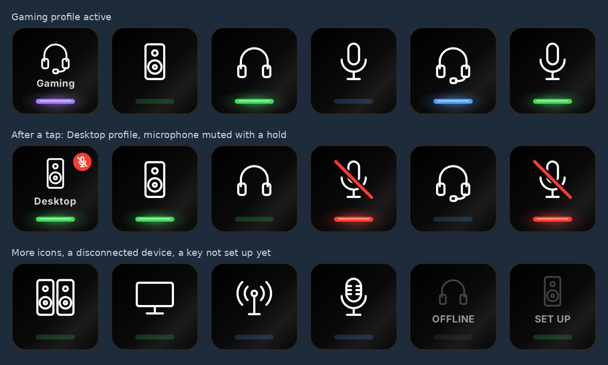

# Audio Profiles

Switch Windows speakers, headphones, microphones and complete audio setups from your Stream Dock,
with live LED indicators under each icon. Built for the Ajazz AKP03E, works on any Stream Dock device.

The keys follow the real Windows audio state. Change your output or microphone anywhere else,
in the tray or in a game, and the LEDs update on their own.

## Install

1. Quit Stream Dock, including the tray icon.
2. Copy the `com.diy.audioprofiles.sdPlugin` folder to `%APPDATA%\HotSpot\StreamDock\plugins\`.
3. Start Stream Dock and drag actions from the **Audio Profiles** category onto your keys.

Windows 10 or 11. Nothing else to install: the bundled `bin\apmhelper.exe` starts and stops with the plugin.
No admin rights, no account.

## Actions

| Action | Tap | Hold (0.5 s) | LED lights when |
|---|---|---|---|
| Sound Output | Make the device the default | Same as tap | It is the default output |
| Microphone | Make the mic the default | Mute or unmute it | It is the default mic; red and crossed out when muted |
| Toggle Profiles | Switch between profile 1 and 2 | Mute or unmute the current mic | Shows the active profile's icon and color; a red corner badge means the mic is muted |
| Profile | Activate the profile | Same as tap | Its output and mic are both the defaults |
| Mic Mute | Mute or unmute the default mic | — | The mic is live; red when muted |

Every action except Toggle Profiles works inside Multi Actions.

## Profiles

Open a Toggle Profiles or Profile key and press **Manage profiles**. Each profile has a name, a sound output,
a microphone (or *Keep current microphone*), an icon and an LED color.

Profiles are saved in Stream Dock, with a backup in `%USERPROFILE%\.audioprofiles-streamdock.json`.
Devices are remembered by ID and by name, so a headset plugged into a different USB port is still found.

## The audio helper

`apmhelper.exe` uses the standard Windows audio APIs, the same approach as EarTrumpet and SoundSwitch.
Windows notifies it of device changes, and it checks mute state every 0.4 seconds.
Source: `source/apmhelper.cpp`. Build with
`x86_64-w64-mingw32-g++ -O2 apmhelper.cpp -o apmhelper.exe -lole32 -luuid -static`.

## Troubleshooting

- Log: `com.diy.audioprofiles.sdPlugin\plugin\log\plugin.log`
- Keys show "…": the helper did not start. Your antivirus may have blocked `apmhelper.exe`; add the plugin folder to its exclusions.
- OFFLINE: the device is unplugged or disabled in Windows sound settings.
