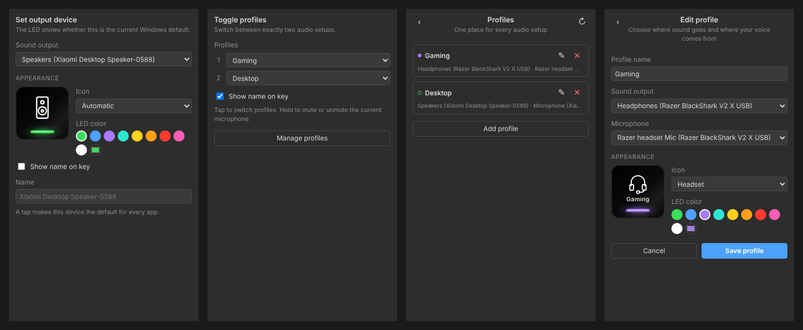

<div align="center">

# 🎧 Audio Profiles

**Switch Windows speakers, headphones, microphones and whole audio setups from your Stream Dock, with live LED indicators under each icon**

[](https://github.com/cherry-terry/ajazz-audio-profiles/archive/refs/heads/main.zip)


</div>

---

## ✨ Features

- 🔊 **One tap to switch** the default speakers, headphones or microphone for every app.
- 🎚️ **Profiles**: an output, a microphone, an icon and an LED color in one key. Flip between two setups (say, *Gaming* and *Desktop*) with a single tap.
- 💡 **LEDs follow the real Windows state**: change devices in the tray or in a game and the keys update on their own.
- 🔇 **Mic mute** with a hold, shown as a red crossed-out mic or a red badge on the profile key.
- 🔌 **Devices are remembered** by ID and by name, so a headset in a different USB port is still found.
- 🪶 **Nothing to install**: no admin rights, no account. The bundled helper starts and stops with the plugin.

## 📦 Installation

> [!IMPORTANT]
> Quit Stream Dock completely, including the tray icon, before copying files.

1. Copy the `com.diy.audioprofiles.sdPlugin` folder to
   `%APPDATA%\HotSpot\StreamDock\plugins\`
2. Start Stream Dock.
3. Drag actions from the **Audio Profiles** category onto your keys.

## 🎛️ Actions

| Action | Tap | Hold (0.5 s) | LED lights when |
|---|---|---|---|
| **Sound Output** | Make the device the default | Same as tap | It is the default output |
| **Microphone** | Make the mic the default | Mute / unmute it | It is the default mic. Red and crossed out when muted |
| **Toggle Profiles** | Switch between profile 1 and 2 | Mute / unmute the current mic | Shows the active profile's icon and color. Red corner badge = mic muted |
| **Profile** | Activate the profile | Same as tap | Its output and mic are both the defaults |
| **Mic Mute** | Mute / unmute the default mic | — | The mic is live. Red when muted |

Every action except Toggle Profiles works inside Multi Actions.

### Key states

| Looks like | Meaning |
|---|---|
| Colored glowing LED | The device or profile is active |
| Dim LED | Not active right now, tap to switch |
| Red LED, crossed-out mic | Microphone muted |
| Grey icon, **OFFLINE** | Device unplugged or disabled in Windows sound settings |
| **SET UP** | The key has no device chosen yet, open its settings |

## 🎚️ Profiles



Open a **Toggle Profiles** or **Profile** key and press **Manage profiles**. Each profile has:

| Setting | |
|---|---|
| Name | Shown on the key if *Show name on key* is on |
| Sound output | Speakers or headphones to make default |
| Microphone | A specific mic, or *Keep current microphone* |
| Icon | Headset, headphones, speaker, monitor, mic and more |
| LED color | 8 presets or a custom color |

Profiles are saved in Stream Dock, with a backup in `%USERPROFILE%\.audioprofiles-streamdock.json`.

## ⚙️ How it works

`bin\apmhelper.exe` uses the standard Windows audio APIs, the same approach as EarTrumpet and SoundSwitch. Windows notifies it of device changes, and it checks mute state every 0.4 seconds.

<details>
<summary><b>Building the helper</b></summary>

Source: `source/apmhelper.cpp`

```bash
x86_64-w64-mingw32-g++ -O2 apmhelper.cpp -o apmhelper.exe -lole32 -luuid -static
```

</details>

## 🛠️ Troubleshooting

| Problem | Fix |
|---|---|
| Keys show `…` | The helper didn't start. Your antivirus may have blocked `apmhelper.exe`: add the plugin folder to its exclusions. |
| **OFFLINE** on a key | The device is unplugged or disabled in Windows sound settings. |

Plugin log: `com.diy.audioprofiles.sdPlugin\plugin\log\plugin.log`

## 📄 License

[MIT](LICENSE). Not affiliated with Ajazz.
